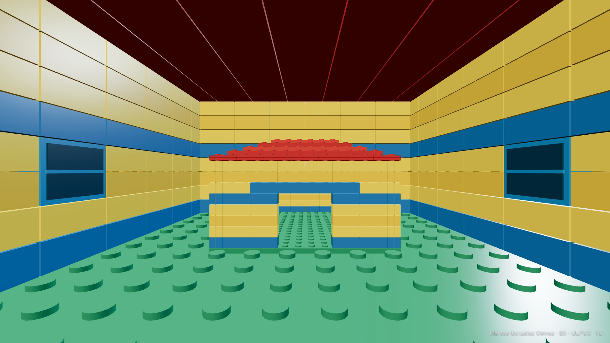
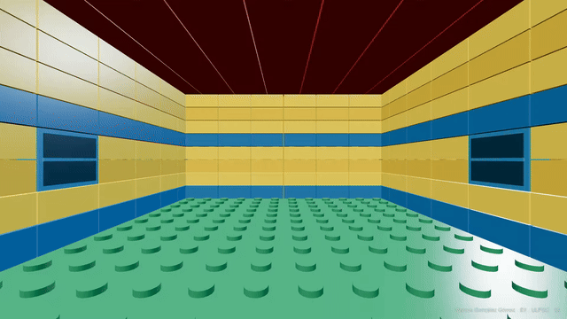

# BRICKCEPTION 

**Autor:** Marcos González Gómez  
**Titulación:** Grado en Ingeniería Informática  
**Centro:** Escuela de Ingeniería Informática (EII), Universidad de Las Palmas de Gran Canaria (ULPGC)  
**Asignatura:** Informática Gráfica  
**Práctica:** Sesión 11 — Animación

## 1. Descripción

Animación en **JavaScript vanilla con Three.js, Ammo.js y Tween.js**. Dentro de una casa de bloques tipo LEGO, **237 piezas caen y construyen otra casa** con paredes, ventanas, puerta y tejado. La cámara entra por la puerta de la copia y recupera el encuadre inicial, formando un *seamless loop* de **20 segundos**.

La física del montaje se calcula con Ammo.js. Tween.js anima la cámara. La firma aparece como marca de agua discreta, también en el vídeo.

## 2. Capturas y demostración

**[Ver la práctica en CodeSandbox](https://codesandbox.io/p/sandbox/busy-ben-96ym37)**

*Figura 1. Casa interior con paredes, ventanas, puerta y tejado.*

*Figura 2. Un ciclo completo de construcción y entrada de cámara.*

**[Ver el vídeo de la práctica](./capturas/demo.webm)**

Una vuelta completa en WebM/VP9, **1920 × 1080**, con autoría visible.

## 3. Funcionalidades

| Función | Descripción |
|---|---|
| Construcción física | Base, 222 ladrillos, dos ventanas, un dintel y once placas de tejado con masa y colisiones. |
| Montaje por capas | Las piezas caen por carriles verticales y se apoyan mediante contactos de Ammo.js. |
| Recursión | La hija tiene el 40 % del tamaño de la madre; se reutilizan dos casas. |
| Grabación | Exportación de un ciclo Full HD con marca de agua. |

## 4. Controles

| Tecla | Acción |
|---|---|
| **Espacio** | Pausar o continuar. |
| **R** | Reiniciar. |
| **← / →**, en pausa | Retroceder o avanzar medio segundo. |
| **G** | Reiniciar y grabar un ciclo completo. |

Mantener visible la pestaña durante la grabación. La preparación inicial tarda unos segundos mientras se calcula la casa madre ya asentada.

## 5. Ejecución

La práctica está disponible en **[CodeSandbox](https://codesandbox.io/p/sandbox/busy-ben-96ym37)**. El punto de entrada es `index.html`, situado en la raíz, y las carpetas `src/` y `vendor/` conservan sus rutas relativas. No requiere instalar paquetes ni compilar: las bibliotecas están incluidas en `vendor/`.

Para ejecutarlo en local, abrir `index.html` mediante **Live Server**. Los módulos ES requieren HTTP; no se ejecutan abriendo el archivo directamente con `file://`.

## 6. Desarrollo

### 6.1. Física con Ammo.js

`blueprint.js` define piezas, masas, colores y tiempos de liberación. `physics.js` crea un `btDiscreteDynamicsWorld` con un suelo estático y **237 cuerpos rígidos dinámicos** de forma `btBoxShape`. La gravedad es **(0, −18, 0)**, el paso fijo **1/120 s**, la fricción **0,9** y la restitución **0,025**.

La base tiene masa 80; ladrillos y ventanas, 1,5; el dintel, 5; y las placas del tejado, 4 u 8. Las alturas finales resultan de los contactos: no se colocan mediante tweens. Las transformaciones de `btMotionState` se copian a las mallas Three.js.

`setLinearFactor(0,1,0)` y `setAngularFactor(0,0,0)` actúan como **guías de montaje**: permiten la caída vertical y evitan deriva lateral y vuelcos. Los tetones son visuales; no se simula su encaje mecánico ni deformación. La geometría utiliza cajas, cilindros e `InstancedMesh` para los tetones.

### 6.2. Secuencia y cierre

La base cae primero; las paredes, ventanas y dintel se montan por hiladas; después cae el tejado. A los 14 segundos termina la simulación del montaje y comienza el avance de cámara, mediante un `TWEEN.Tween` con `Quintic.InOut`. El último segundo queda en reposo.

La madre utiliza el estado asentado de esa misma simulación. La posición, el objetivo y los planos de recorte de la cámara se ajustan a la escala de la hija. Al entrar, sus paredes, suelo y techo ocultan la madre; unas láminas interiores cierran las juntas visuales. El siguiente ciclo reinicia la física y reutiliza las dos casas. Los objetos nativos anteriores se liberan con `Ammo.destroy`.

### 6.3. Grabación

Se utilizan `captureStream(30)` y `MediaRecorder`. La marca de agua se dibuja también en el canvas del vídeo, porque el texto HTML no forma parte de la captura WebGL.

## 7. Estructura

- `index.html` y `style.css`: visor y marca de agua.
- `src/`: plano, física, geometría, cámara y animación.
- `vendor/`: Three.js, Tween.js, Ammo.js y sus licencias.
- `capturas/`: imagen, GIF animado y vídeo de la práctica.
- `README.md`: documentación de la práctica.

## 8. Fuentes

- Material docente de Animación de la sesión 11, especialmente `script_45_ammo.js` para cuerpos rígidos, masas y sincronización física.
- `script_41_tween.js` y `script_42_tween_cubos.js`: interpolación de la cámara.
- `script_43_tween_record.js`: captura con MediaRecorder.
- [Three.js](https://github.com/mrdoob/three.js/tree/r160), versión 0.160.1; licencia MIT en `vendor/THREE-LICENSE.txt`.
- [Tween.js](https://github.com/tweenjs/tween.js/tree/v23.1.3), versión 23.1.3; licencia MIT en `vendor/TWEEN-LICENSE.txt`.
- [Ammo.js](https://github.com/kripken/ammo.js), distribución de `ammojs-typed` 1.0.6; licencia zlib en `vendor/AMMO-LICENSE.txt`.
- Bloques tipo LEGO como referencia visual.

Se ha utilizado **Codex (OpenAI)** como herramienta de apoyo durante el desarrollo de la práctica.
