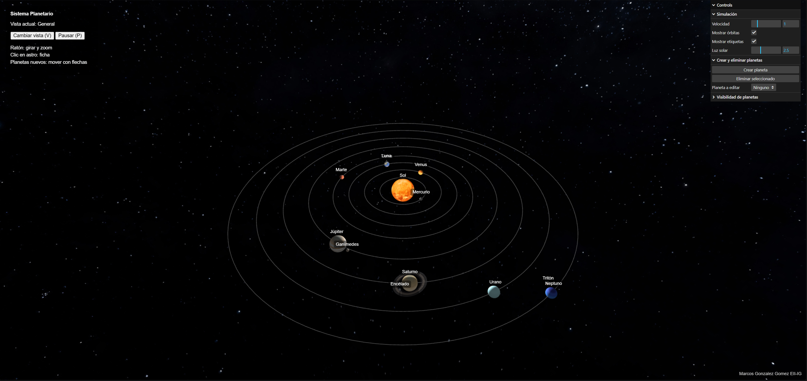
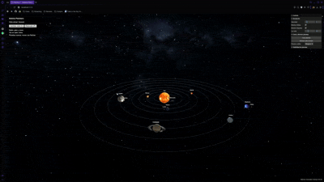

# Sistema Planetario Interactivo

**Autor:** Marcos González Gómez  
**Titulación:** Grado en Ingeniería Informática  
**Centro:** Escuela de Ingeniería Informática (EII), Universidad de Las Palmas de Gran Canaria (ULPGC)  
**Asignatura:** Informática Gráfica  
**Práctica:** Sesiones 6 y 7 — Sistema Planetario

## 1. Descripción

Desarrollo de un **sistema planetario tridimensional e interactivo** con **Three.js y WebGL**. El proyecto representa el Sol, los ocho planetas y cuatro satélites, con movimientos de rotación y traslación, iluminación, texturas y diferentes posibilidades de navegación e interacción.

La aplicación combina la exploración visual del sistema solar con **fichas didácticas**, controles de simulación y herramientas para **crear y editar planetas ficticios y sus lunas**.

> **Nota:** los tamaños, las distancias y las velocidades orbitales son adaptaciones visuales y no reproducen las escalas astronómicas reales.

## 2. Capturas y demostración

### Vista de la aplicación



*Figura 1. Captura de la escena tridimensional del sistema planetario.*

### Demostración animada



*Figura 2. Fragmento animado de la simulación y sus posibilidades de interacción.*

### Vídeo completo

**[Ver el vídeo completo de la demostración](./capturas/video.mp4)**

*Vídeo 1. Grabación completa de la práctica, con las vistas de cámara, la información de los astros, la configuración y la creación y edición de cuerpos celestes.*

La aplicación muestra la firma **Marcos Gonzalez Gomez EII-IG** en la esquina inferior derecha.

## 3. Funcionalidades

### 3.1. Representación y animación del sistema solar

La escena incorpora el **Sol y los ocho planetas**: Mercurio, Venus, Tierra, Marte, Júpiter, Saturno, Urano y Neptuno. También se representan cuatro satélites naturales: **la Luna, Ganímedes, Encélado y Tritón**.

Cada planeta sigue una **órbita circular alrededor del Sol** y gira sobre su propio eje. Las lunas, a su vez, orbitan alrededor de sus planetas. La simulación utiliza velocidades diferenciadas para que el movimiento de los distintos cuerpos sea apreciable. Las trayectorias orbitales se dibujan en la escena y pueden ocultarse desde el panel de opciones.

**Detalles visuales:**

- **Sol:** esfera texturizada que actúa como centro del sistema y origen de la iluminación puntual.
- **Planetas y lunas:** esferas con mapas de superficie y distintos radios.
- **Saturno:** anillos construidos mediante una geometría anular y una textura con transparencia.
- **Tierra:** mapa de superficie, mapa especular para los reflejos y una segunda esfera de nubes semitransparentes que gira de forma independiente.
- **Entorno:** fondo estelar envolvente para situar los astros en el espacio.

### 3.2. Iluminación y materiales

El Sol se representa con un material que no necesita recibir iluminación externa. Una **luz puntual** situada en su posición ilumina los demás cuerpos y se complementa con una iluminación ambiental tenue. La escena utiliza materiales `MeshPhongMaterial` y admite sombras.

La intensidad de la luz solar puede modificarse en tiempo real desde el panel de configuración, lo que permite apreciar los efectos de la iluminación sobre los planetas.

### 3.3. Dos modos de exploración

| Vista | Descripción |
|---|---|
| **General** | Cámara orbital con `OrbitControls`. Permite girar alrededor de la escena, hacer zoom y observar el conjunto del sistema planetario. |
| **Nave** | Cámara subjetiva con `FlyControls`. Permite desplazarse libremente por el espacio y cambiar de orientación. |

Se puede alternar entre ambas vistas con el botón **Cambiar vista** o la tecla **`V`**. En la vista de nave aparece un selector para elegir un planeta y ejecutar **Saltar al planeta**, que sitúa la cámara cerca del destino.

### 3.4. Fichas didácticas y etiquetas

Mediante un **clic sobre el Sol o uno de los planetas**, el sistema identifica el objeto utilizando `Raycaster` y muestra una ficha informativa.

Las fichas incluyen descripciones, distancias medias reales al Sol, duración de los días y años, información sobre satélites y curiosidades. Estos datos son informativos: no determinan las escalas usadas en la animación.

Además, los nombres de los astros se muestran como **etiquetas flotantes** proyectadas sobre la escena. El usuario puede activarlas o desactivarlas desde el panel derecho.

### 3.5. Configuración de la simulación

El panel de **lil-gui** reúne los ajustes interactivos:

| Ajuste | Qué permite hacer |
|---|---|
| **Velocidad** | Acelerar, ralentizar o detener el avance temporal de la simulación. |
| **Mostrar órbitas** | Visualizar u ocultar las trayectorias circulares de los planetas. |
| **Mostrar etiquetas** | Activar o desactivar los nombres sobre los cuerpos celestes. |
| **Luz solar** | Ajustar la intensidad de la fuente de luz principal. |
| **Visibilidad de planetas** | Mostrar u ocultar individualmente los ocho planetas originales. |

La **pausa y reanudación** también están disponibles desde el panel izquierdo y mediante la tecla **`P`**.

### 3.6. Creación y edición de planetas ficticios

Además de los cuerpos originales, la aplicación permite **crear planetas nuevos durante la ejecución**, hasta un máximo de 15 planetas en total.

Al crear uno se le asignan un nombre provisional, un color, un tamaño, una distancia orbital y una velocidad. Puede seleccionarse desde el desplegable **Planeta a editar** y personalizar sus propiedades:

- Nombre y descripción didáctica.
- Tamaño y velocidad orbital.
- Datos informativos como duración del día, duración del año y curiosidades.
- Posición en la escena mediante **`TransformControls`**.

Al mover un planeta ficticio con las flechas de transformación sobre el plano orbital, se recalculan la **distancia y la fase de su órbita**, y se actualiza su trayectoria circular.

Los planetas añadidos pueden eliminarse; **los ocho planetas originales están protegidos frente a su eliminación**.

### 3.7. Creación y edición de lunas

Cada planeta ficticio puede recibir nuevas lunas. En el panel de edición es posible establecer su **nombre, color, radio, distancia al planeta y velocidad orbital**.

Una vez creadas, las lunas se incorporan a la animación y aparecen en un apartado específico que permite **volver a modificar sus propiedades**. También se actualiza el número de lunas de la ficha del planeta correspondiente.

## 4. Controles

| Acción | Control |
|---|---|
| Girar la vista general | Arrastrar el ratón |
| Acercar o alejar la vista general | Rueda del ratón |
| Seleccionar un astro y abrir su ficha | Clic izquierdo |
| Cambiar entre vista general y nave | **`V`** o botón *Cambiar vista* |
| Pausar o reanudar la simulación | **`P`** o botón *Pausar* |
| Avanzar o retroceder con la nave | **`W` / `S`** |
| Desplazarse lateralmente con la nave | **`A` / `D`** |
| Ascender o descender con la nave | **`R` / `F`** |
| Inclinar la nave | **`Q` / `E`** |
| Orientar la nave | Arrastrar el ratón |
| Desplazarse a un planeta | Seleccionar destino y pulsar *Saltar al planeta* |
| Mover un planeta ficticio | Seleccionarlo y utilizar las flechas de `TransformControls` |

## 5. Instalación y ejecución

Se necesita **Node.js con npm** y un navegador compatible con WebGL.

```bash
# Clonar el repositorio
git clone https://github.com/mgz00/IG.git
cd IG/S6_7

# Instalar las dependencias
npm install

# Iniciar el servidor de desarrollo
npm start
```

Abrir la dirección indicada por Parcel en la consola, normalmente **http://localhost:1234**.

En PowerShell, si está bloqueada la ejecución de `npm`, puede utilizarse `npm.cmd install` y `npm.cmd start`.

## 6. Organización del proyecto

```text
S6_7/
├── capturas/
│   ├── captura.png
│   ├── video.gif
│   └── video.mp4
├── src/
│   ├── index.html
│   ├── script.js
│   └── textures/
├── package.json
├── package-lock.json
└── README.md
```

`src/script.js` contiene la escena, las cámaras, los cuerpos celestes, sus animaciones y la interfaz. `src/textures/` reúne los recursos gráficos. En `capturas/` se incluyen la imagen de presentación, el GIF y la demostración completa.

## 7. Tecnologías utilizadas

| Tecnología | Uso en el proyecto |
|---|---|
| **JavaScript** | Lógica, gestión de objetos y animación. |
| **Three.js / WebGL** | Creación y representación de la escena 3D. |
| **OrbitControls** | Cámara de exploración general. |
| **FlyControls** | Cámara subjetiva con navegación libre. |
| **TransformControls** | Modificación interactiva de planetas ficticios. |
| **Raycaster** | Selección de objetos mediante el ratón. |
| **lil-gui** | Interfaz de parámetros y edición. |
| **Node.js, npm y Parcel** | Dependencias y servidor de desarrollo. |

## 8. Fuentes y atribuciones

### Texturas

Los mapas de textura proceden de **[Solar System Scope](https://www.solarsystemscope.com/textures/)** y se utilizan con atribución conforme a su licencia **[Creative Commons Attribution 4.0](https://creativecommons.org/licenses/by/4.0/)**.

Se emplean texturas del Sol, planetas, Luna, Tierra (incluidas nubes y reflejos), anillos de Saturno y fondo estelar. Las texturas ficticias de **Ceres, Eris y Makemake** se reutilizan para representar otras lunas de la simulación; no constituyen reproducciones astronómicas exactas de esos satélites.

### Bibliotecas y documentación

- [Three.js](https://threejs.org/) y su [documentación](https://threejs.org/docs/).
- [OrbitControls](https://threejs.org/docs/pages/OrbitControls.html).
- [FlyControls](https://threejs.org/docs/pages/FlyControls.html).
- [TransformControls](https://threejs.org/docs/pages/TransformControls.html).
- [lil-gui](https://lil-gui.georgealways.com/).
- [Parcel](https://parceljs.org/).

### Información astronómica

Los datos de las fichas son aproximados y se presentan con fines didácticos. Las distancias y los tiempos reales no se corresponden directamente con los valores empleados para representar las órbitas.

## 9. Uso de inteligencia artificial

Se ha utilizado **ChatGPT (OpenAI)** como herramienta de apoyo para resolver dudas de Three.js, explorar alternativas de implementación, revisar y depurar código, y preparar esta documentación. Se consultaron, entre otras cuestiones, la animación orbital, las cámaras, la selección mediante `Raycaster`, `TransformControls`, la edición dinámica y los materiales y texturas.
