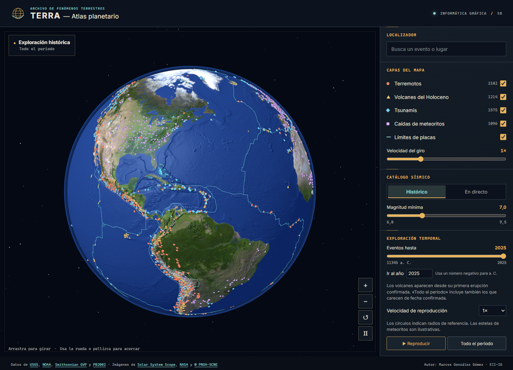
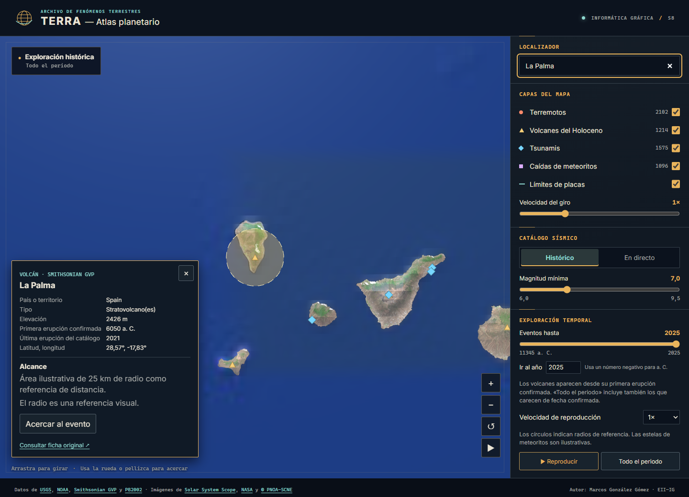

# TERRA — Atlas planetario

**Autor:** Marcos González Gómez  
**Titulación:** Grado en Ingeniería Informática  
**Centro:** Escuela de Ingeniería Informática (EII), Universidad de Las Palmas de Gran Canaria (ULPGC)  
**Asignatura:** Informática Gráfica  
**Práctica:** Sesión 8 — Terrenos y mapas geográficos

## 1. Descripción

**TERRA — Atlas planetario** es un visor tridimensional de terremotos, volcanes, tsunamis y caídas de meteoritos construido con **Three.js y WebGL**. Cada capa de eventos se puede activar por separado, junto con los límites de placas tectónicas.

La interfaz toma como referencia las cartas estelares y la instrumentación espacial. El globo conserva la vista principal y el panel lateral reúne el localizador, las capas, el filtro sísmico y los controles de reproducción.

El objetivo es explorar cómo se distribuyen la sismicidad y el vulcanismo. Al activar los límites de placa se puede observar la concentración de ambos fenómenos en regiones como el Pacífico y comparar esas regiones con zonas intraplaca como Canarias.

## 2. Capturas y demostración

[**Ver o descargar el video demostración de TERRA **](./capturas/video.mp4)




*Figura 1. Vista inicial con las capas de eventos y los límites tectónicos.*



*Figura 2. La Palma aparece con el radio de referencia común a todos los volcanes.*

## 3. Funcionalidades

| Función | Descripción |
|---|---|
| **Globo 3D** | Cámara con giro automático, textura global de hasta 8192 × 4096, relieve terrestre y submarino, atmósfera y estrellas dibujadas en 3D. La ortofoto de Canarias aporta detalle al acercarse. |
| **Catálogo sísmico histórico** | 14.358 terremotos de magnitud 6 o superior del USGS entre 1900 y 2025 y 914 terremotos significativos anteriores a 1900 de NOAA con coordenadas y magnitud de al menos 6. La vista inicial muestra los de magnitud 7 o superior. |
| **Catálogo de volcanes** | 1.214 volcanes del Holoceno. Se distinguen con triángulos amarillos. El catálogo tiene una primera erupción confirmada con año utilizable para 847 de ellos. |
| **Tsunamis** | 1.575 orígenes de tsunamis confirmados o probables de NOAA con coordenadas y fecha hasta 2025. Los rombos azules abren una ficha con causa, altura máxima, número de observaciones y enlace al registro original. |
| **Meteoritos** | 1.096 caídas observadas con coordenadas entre 860 y 2013. Los cuadrados violetas abren una ficha con el año, la clasificación, la masa registrada y un enlace al catálogo original. |
| **Límites de placas** | 241 trazados del modelo PB2002, representados mediante líneas turquesa. |
| **Selección y fichas** | Un clic en un marcador muestra su ubicación, coordenadas, datos del catálogo y enlace al registro original. Los círculos sísmicos aumentan de tamaño con la magnitud. |
| **Alcance de eventos** | La zona de referencia se muestra con relleno translúcido de 100 km de radio para terremotos y de 25 km para todos los volcanes. Los contornos de intensidad modelada de USGS ShakeMap se dibujan como líneas. |
| **Filtro por magnitud** | Permite ajustar el umbral de cada modo sísmico. Los contadores indican cuántos registros cumplen los filtros y pertenecen a las capas activas. |
| **Modo En directo** | Consulta el feed USGS de magnitud 2,5 o superior de las últimas 24 horas al entrar y cada cinco minutos mientras está activo. Muestra la hora de la consulta, permite recarga manual y conserva los últimos datos si falla una petición. |
| **Exploración temporal** | El modo histórico acumula terremotos, tsunamis, volcanes y caídas de meteoritos hasta el año elegido, desde 11.345 a. C. hasta 2025. Cada volcán aparece desde su primera erupción confirmada. «Todo el periodo» incluye también los volcanes sin fecha confirmada. |
| **Búsqueda** | Localiza volcanes, tsunamis, meteoritos y sismos del modo activo. Al elegir un resultado se activa su capa y se ajustan los filtros necesarios para mostrarlo. |

Los catálogos representan periodos y criterios distintos. El tamaño de los símbolos sísmicos es visual y los puntos se colocan sobre la superficie a partir de las coordenadas de los epicentros. La profundidad se consulta en la ficha.

## 4. Controles

| Acción | Control |
|---|---|
| Girar el globo | Arrastrar el ratón o un dedo |
| Acercar o alejar | Rueda, gesto de pellizco o botones **+ / −** |
| Volver a la vista inicial | Botón **↺** |
| Pausar o reanudar el giro automático | Botón **Ⅱ / ▶** junto al globo. El giro también se detiene al usar la cámara o seleccionar un evento. |
| Consultar un evento | Clic en un marcador o selección en el buscador |
| Elegir el primer resultado | **Intro** desde el buscador |
| Cerrar resultados o ficha | **Esc** |
| Ver eventos hasta un año | Deslizador en **Exploración temporal** |
| Cambiar el ritmo de la cronología | **Velocidad de reproducción** permite avanzar a 1 año por segundo o recorrer el periodo a 0,5×, 1×, 2× o 4×. |
| Cambiar el ritmo de la cámara | Deslizador **Velocidad del giro**, de 0,25× a 3×. |
| Reproducir, pausar o restaurar el periodo | Botones del panel temporal |

## 5. Instalación y ejecución

Se necesita Node.js **20.19+ en la rama 20 o 22.12+** y un navegador con WebGL.

```bash
git clone https://github.com/mgz00/IG.git
cd IG/S8
npm ci
npm start
```

Abre la dirección que muestra Vite, normalmente `http://localhost:5173`. En PowerShell puedes ejecutar `npm.cmd ci` y `npm.cmd start` si el sistema bloquea el script de npm. Con `npm run build` se genera la aplicación estática en `dist/` y con `npm run preview` se sirve esa compilación localmente.

Una vez instaladas las dependencias, el visor histórico funciona con sus recursos locales. El modo En directo y los enlaces a fichas originales requieren Internet.

Para repetir el recorrido del vídeo, busca `us6000jllz` y pulsa **Centrar en el alcance** para ver el ShakeMap de Pazarcık. Al elegir un volcán, su ficha muestra un área ilustrativa de 25 km, como en el resto del catálogo. Con **Ensisheim** puedes consultar la ficha del meteorito y reproducir su caída fijando la cronología en 1488.

## 6. Organización del proyecto

```text
S8/
├── capturas/
│   ├── captura.png
│   ├── canarias.png
│   └── video.mp4
├── public/
│   ├── data/        # Catálogos GeoJSON locales
│   └── textures/    # Imágenes globales y regionales, relieve y fuente Inter
├── src/
│   ├── data.js     # Lectura y adaptación de los datos
│   ├── earth.js    # Texturas, relieve, ortofoto y atmósfera
│   ├── sky.js      # Campo de estrellas
│   ├── footprint.js # Selección y consulta de datos de alcance
│   ├── globe.js    # Escena, coordenadas, capas, cámara y selección
│   ├── main.js     # Interfaz, filtros, búsqueda y cronología
│   └── style.css
├── index.html
├── package.json
├── package-lock.json
├── vite.config.js
└── README.md
```

## 7. Técnicas utilizadas

La longitud y latitud en grados se convierten a coordenadas cartesianas sobre una esfera, a partir del planteamiento de geolocalización de los ejemplos de Sitycleta. Los trazados de placas se proyectan como segmentos de línea y se subdividen para ajustarse a la curvatura. Este paso adapta la representación de polilíneas del ejemplo de OpenStreetMap.

Los marcadores de cada capa se agrupan en una geometría `BufferGeometry` que Three.js dibuja con `Points`. Un shader define la forma, el color y el tamaño de cada símbolo. La selección compara la distancia del clic a la posición proyectada de los marcadores visibles. La cronología actualiza el año de corte y filtra el catálogo, siguiendo el planteamiento de la animación temporal del ejemplo de préstamos de Sitycleta.

El sombreado combina elevación continental y batimetría. La batimetría se atenúa al acercar la cámara. La ortofoto de Canarias se alinea con las coordenadas UV del globo y su transparencia conserva el océano de la textura global. Los círculos de referencia y los contornos de alcance se dibujan sobre la esfera. El mapa sísmico local de Pazarcık está disponible sin conexión. La consulta de otros ShakeMap requiere Internet y depende de la cobertura de USGS.

Durante la reproducción, los eventos que entran se iluminan durante aproximadamente un segundo y después conservan su marcador habitual. Los tsunamis muestran un pulso en el origen. Los terremotos y volcanes muestran sus áreas de referencia y, cuando hay un ShakeMap disponible, el contorno sísmico.

Las caídas de meteoritos muestran una estela ilustrativa que termina en las coordenadas registradas. El archivo `meteoritos.geojson` conserva las caídas válidas observadas del CSV de NASA con año y coordenadas utilizables.

### Preparación de los datos

Los catálogos históricos se descargaron y se guardaron en `public/data/`. Los puntos usan el orden longitud, latitud de GeoJSON y conservan los campos necesarios para dibujar las capas, aplicar los filtros y enlazar con la fuente. El visor convierte cada fuente a un formato común al leerla. Las fichas muestran «Sin datos» cuando falta una medida.

| Capa | Criterio de selección y lectura |
|---|---|
| Terremotos | USGS cubre 1900–2025 y NOAA aporta sismos significativos anteriores a 1900. Ambos conjuntos usan un umbral de magnitud 6. El recuento de eventos antiguos depende de la documentación histórica disponible en cada región. |
| Volcanes | El Smithsonian aporta las ubicaciones y características de los volcanes del Holoceno. La cronología cruza el número de cada volcán con el año de su primera erupción confirmada. La vista de todo el periodo permite consultar también los que carecen de ese año. |
| Tsunamis | NOAA aporta los orígenes confirmados o probables con coordenadas y año. La ficha muestra la altura máxima registrada cuando está disponible y enlaza a las observaciones de la fuente. Para comparar observaciones costeras hay que abrir ese registro. |
| Meteoritos | Se seleccionaron caídas observadas y válidas del CSV de NASA, con año y coordenadas utilizables. El catálogo local abarca de 860 a 2013. La animación usa el lugar registrado para colocar el final de la estela. |
| En directo | El visor consulta el GeoJSON de USGS con sismos de magnitud 2,5 o superior de las últimas 24 horas. Los datos se solicitan al entrar y cada cinco minutos mientras el modo está abierto. Si una consulta falla, se conserva la última respuesta disponible. |

Los radios de 100 km para terremotos y 25 km para todos los volcanes sirven para apreciar distancias. Son referencias visuales. ShakeMap representa intensidad de sacudida modelada y puede consultarse para los terremotos que tengan ese producto disponible.

## 8. Fuentes, selección y atribuciones

Los catálogos históricos se descargaron el **13 de noviembre de 2026**. Los archivos locales guardan las coordenadas y propiedades que necesita el visor, además del identificador de origen cuando está disponible. El archivo de placas se conserva en GeoJSON. La fuente de cada ficha se identifica en la propia ficha del evento.

| Datos | Fuente y uso en el proyecto |
|---|---|
| Terremotos desde 1900 | Servicio GeoJSON FDSN de USGS, filtrado a eventos sísmicos de magnitud 6 o superior y al periodo 1900–2025. [Catálogo histórico consultado](https://earthquake.usgs.gov/fdsnws/event/1/query?format=geojson&starttime=1900-01-01&endtime=2026-01-01&minmagnitude=6&eventtype=earthquake&orderby=time-asc). |
| Terremotos anteriores a 1900 | NOAA NCEI/WDS, *Significant Earthquake Database*. Se conservan eventos con fecha, magnitud de al menos 6 y coordenadas válidas. El catálogo reúne sismos significativos documentados, por lo que la cobertura depende de los registros históricos disponibles. [DOI](https://doi.org/10.7289/V5TD9V7K). |
| Tsunamis | NOAA NCEI/WDS, *Global Historical Tsunami Database*, exportado desde HazEL. Se muestran orígenes confirmados o probables con coordenadas y año hasta 2025. Las observaciones asociadas se consultan en el registro de origen. [DOI](https://doi.org/10.7289/V5PN93H7). |
| Meteoritos | Catálogo *Meteorite Landings* publicado en NASA Open Data, compilado con registros de The Meteoritical Society. Se conservan caídas observadas y válidas con año y coordenadas utilizables, entre 860 y 2013. [Catálogo](https://data.nasa.gov/dataset/meteorite-landings). |
| Terremotos en directo | Feed GeoJSON de USGS con magnitud 2,5 o superior en las últimas 24 horas. Se solicita al entrar al modo y cada cinco minutos mientras permanece abierto. [Feed](https://earthquake.usgs.gov/earthquakes/feed/v1.0/summary/2.5_day.geojson). |
| Volcanes | Smithsonian Institution, Global Volcanism Program, *Volcanoes of the World*, v5.4.0, compilado por E. Venzke. El visor muestra los 1.214 volcanes del Holoceno y cruza sus identificadores con el año de primera erupción confirmada cuando existe. [DOI](https://doi.org/10.5479/si.GVP.VOTW5-2026.5.4) · [Servicio de datos](https://volcano.si.edu/database/webservices.cfm) · [Términos de uso](https://volcano.si.edu/gvp_termsofuse.cfm). |
| Tsunami y terremotos mostrados en el globo | Cada marcador usa la ubicación puntual del origen o epicentro catalogado. La profundidad de un sismo se presenta en su ficha. Los círculos translúcidos de 100 km para sismos y 25 km para volcanes son radios de referencia visual, no límites calculados del área afectada. |

Los límites de placa parten del modelo de Peter Bird (2003), *An updated digital model of plate boundaries*. La versión GeoJSON es una conversión de Hugo Ahlenius, Nordpil, publicada bajo licencia [ODC Attribution 1.0](https://opendatacommons.org/licenses/by/1-0/). [Artículo original](https://doi.org/10.1029/2001GC000252) · [Datos PB2002](https://github.com/fraxen/tectonicplates).

La textura diurna global de hasta 8K procede de [Solar System Scope](https://www.solarsystemscope.com/textures/) bajo licencia [CC BY 4.0](https://creativecommons.org/licenses/by/4.0/). Las imágenes de elevación terrestre y batimetría oceánica proceden de [NASA Blue Marble Next Generation](https://science.nasa.gov/earth/earth-observatory/blue-marble-next-generation/topography-bathymetry-maps/). El detalle de las islas Canarias usa ortofotografía PNOA–SCNE, del IGN y las comunidades autónomas, bajo [licencia CC BY 4.0](https://datos.gob.es/es/catalogo/e00125901-spaignpnoama). La tipografía Inter se distribuye bajo [SIL Open Font License](./public/textures/OFL-Inter.txt). El fondo de estrellas se genera en el propio visor.

Las líneas ShakeMap representan contornos de intensidad modelada, no una medición directa del daño. El mapa de Pazarcık está guardado localmente a partir del producto de [USGS ShakeMap](https://earthquake.usgs.gov/data/shakemap/). [Producto de Pazarcık](https://earthquake.usgs.gov/earthquakes/eventpage/us6000jllz/shakemap/intensity). Para otros terremotos, el visor consulta el producto si USGS lo publica y hay conexión.

## 9. Uso de inteligencia artificial

Se utilizó ChatGPT (OpenAI) como apoyo para resolver dudas de Three.js y cartografía, comparar alternativas para las capas, la cronología y la representación del relieve, revisar errores y organizar esta documentación. La selección de funcionalidades, integración de los recursos y revisión final del resultado forman parte del trabajo realizado para la práctica.

