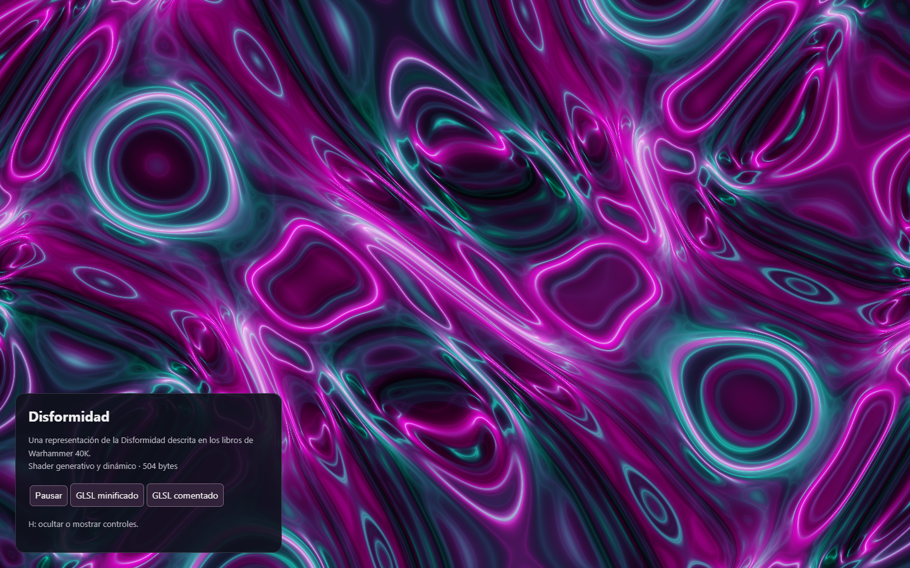
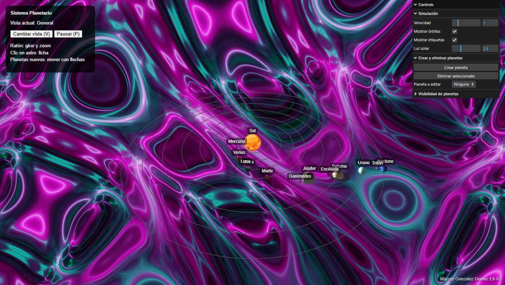

# Disformidad — Shaders generativos

**Autor:** Marcos González Gómez  
**Titulación:** Grado en Ingeniería Informática  
**Centro:** Escuela de Ingeniería Informática (EII), Universidad de Las Palmas de Gran Canaria (ULPGC)  
**Asignatura:** Informática Gráfica  
**Práctica:** Sesiones 9 y 10 — Shaders

## 1. Descripción

Desarrollo de un **shader de fragmentos generativo y dinámico en GLSL** que produce pliegues de gas y corrientes de energía en tonos violetas, magenta y turquesa. La imagen se calcula por píxel, sin texturas externas.

**Intención:** representar la Disformidad descrita en los libros de **Warhammer 40K** mediante formas cambiantes, gas y energía de colores sobrenaturales.

El shader minificado ocupa **504 bytes UTF-8**, incluidos precisión y uniforms, sin BOM ni salto final. Se incluye también la misma fórmula en una versión legible y comentada. Como ampliación, se utiliza como fondo de una copia del sistema planetario de las sesiones 6 y 7.

## 2. Capturas y demostración



*Figura 1. Captura real del shader en ejecución.*



*Figura 2. Integración del mismo efecto en la copia del sistema planetario.*

La animación se puede ver abriendo [el visor independiente](./index.html). La copia del sistema planetario incluye sus [instrucciones de ejecución](./sistema-planetario/README.md).

## 3. Funcionalidades

| Función | Descripción |
|---|---|
| Generación procedural | Cinco capas de ondas y deformaciones calculan toda la imagen en el shader. |
| Animación | El tiempo modifica el dominio, los pliegues y la distribución cromática. |
| Color | Gas violeta y magenta con acentos turquesa. |
| Tiny code | Shader autónomo de 504 bytes, por debajo del máximo de 512. |
| Código comentado | La misma fórmula con comentarios que explican cada etapa. |
| Integración | Fondo animado del sistema planetario, compatible con sus dos cámaras, pausa y velocidad. |

## 4. Controles

En el visor independiente, **Pausar/Reanudar** controla la animación y **H** muestra u oculta el panel. Los enlaces permiten descargar el código minificado y el comentado. En el sistema planetario se conservan sus controles originales.

## 5. Instalación y ejecución

El visor no necesita instalar dependencias: abrir `index.html` con un navegador que admita WebGL.

Para usar el shader en [el editor de The Book of Shaders](https://editor.thebookofshaders.com/), sustituir el código del editor por el contenido completo de `shaders/disformidad.frag`, sin etiquetas HTML ni comillas.

Después de modificar la versión comentada, ejecutar:

```sh
node preparar.mjs
```

Este comando genera el minificado, los datos del visor y el módulo usado por Three.js, y falla si se superan 512 bytes. Para recompilar la integración, ejecutar `npm run build` desde `sistema-planetario`.

## 6. Desarrollo del shader

### 6.1. Coordenadas y entradas

Se utilizan `u_resolution` (dimensiones reales del dibujo) y `u_time` (segundos). Las coordenadas de `gl_FragCoord` se centran y ambos ejes se normalizan por la altura, conservando las proporciones. Una primera onda cruzada rompe la regularidad del dominio.

### 6.2. Capas y deformación

Un bucle de cinco iteraciones rota las coordenadas mediante una matriz y las escala por 2.8. El seno produce una repetición continua, y otra onda con ejes intercambiados deforma los pliegues. Las transformaciones de una iteración alimentan la siguiente y generan detalle a distintas escalas.

La estrategia se apoya en el shader que se compartió durante el desarrollo, atribuido a un compañero: capas iteradas, deformaciones y acumulación luminosa. Se adapta esa estrategia al gas y la energía de la Disformidad. La repetición con `fract` de aquella referencia se sustituye por seno para evitar fronteras visibles entre celdas.

### 6.3. Densidad y energía

La distancia con signo a una curva radial de tres lóbulos define las regiones de cada capa. Una exponencial aporta densidad al interior y una inversa del valor absoluto de la distancia añade luz en las fronteras. Un desplazamiento positivo del denominador evita dividir por cero.

### 6.4. Color y salida

`mix` combina magenta/violeta y turquesa. `smoothstep` delimita las zonas de transición según la capa, las coordenadas deformadas y el tiempo. Los colores de las cinco capas se suman. La expresión `o*o/(1.+o*o)` incrementa el contraste y comprime el brillo en el intervalo de salida. `gl_FragColor` entrega un color opaco.

Es una representación artística 2D; no simula gas físicamente ni implementa ruido de valor. El detalle fino puede presentar aliasing según la resolución.

### 6.5. Integración en Three.js

El mismo GLSL se utiliza en un `ShaderMaterial` aplicado al interior de una esfera que acompaña a la cámara activa. El fondo se dibuja primero, sin escribir profundidad ni recibir iluminación. Se actualizan resolución y tiempo antes de cada render. La pausa y la velocidad siguen la simulación original.

El patrón se calcula en coordenadas de pantalla: mantiene su composición al girar la cámara. No es un panorama 3D. La práctica original de S6_7 se conserva por separado.

## 7. Estructura del proyecto

- `shaders/disformidad.frag`: shader compacto de 504 bytes.
- `shaders/disformidad-readable.frag`: versión equivalente comentada.
- `index.html`: página para ver el shader independiente.
- `visor.js`: configura WebGL, dibuja el shader y controla la animación.
- `shader-sources.js`: datos generados del shader para abrir el visor sin servidor.
- `preparar.mjs`: generación y comprobación del tamaño.
- `sistema-planetario/`: copia de la práctica con el fondo integrado.

## 8. Verificación

Se comprueban compilación en WebGL 1 y adaptación de salida a GLSL ES 3.00 en WebGL 2, igualdad de píxeles entre código comentado y minificado, animación temporal, contraste y alfa opaco, en horizontal y vertical. Los archivos auxiliares de estas pruebas se han retirado de la entrega final.

La integración se compila con Parcel y se prueba en Chrome, incluyendo las dos cámaras y la pausa. No se ha probado manualmente el editor remoto de The Book of Shaders; el código utiliza su estructura estándar de fragment shader y uniforms.

## 9. Fuentes y referencias

- Material docente aportado: README de shaders y ejemplos 32 y 33, para la estructura de GLSL, coordenadas y uniforms de tiempo y resolución.
- Shader compartido por el usuario, atribuido a un compañero: referencia para las capas iteradas y acumulación de brillo. No se atribuye esa estrategia a este trabajo.
- Patricio Gonzalez Vivo y Jen Lowe, [The Book of Shaders](https://thebookofshaders.com/), para formas, patrones y transformación de coordenadas.
- Games Workshop, universo **Warhammer 40K**: inspiración conceptual de la Disformidad. No se reproducen textos ni ilustraciones de los libros.
- [Three.js](https://threejs.org/): integración mediante `ShaderMaterial`.

El código, los ajustes visuales y la documentación se han preparado con asistencia de Codex.
