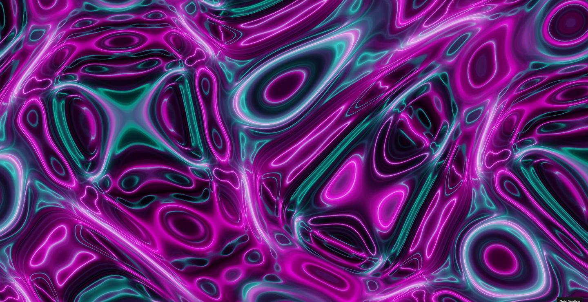
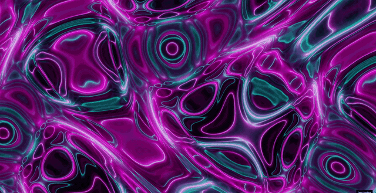
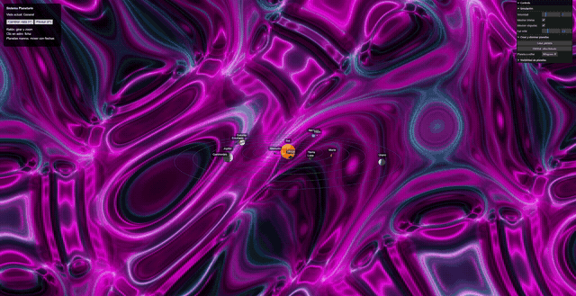

# Disformidad — Shaders generativos

**Autor:** Marcos González Gómez  
**Titulación:** Grado en Ingeniería Informática  
**Centro:** Escuela de Ingeniería Informática (EII), Universidad de Las Palmas de Gran Canaria (ULPGC)  
**Asignatura:** Informática Gráfica  
**Práctica:** Sesiones 9 y 10 — Shaders

## 1. Descripción

Desarrollo de un **shader de fragmentos generativo y dinámico en GLSL** que produce pliegues de gas y corrientes de energía en tonos violetas, magenta y turquesa. La imagen se calcula por píxel, sin texturas externas.

**Intención:** representar la Disformidad descrita en los libros de **Warhammer 40K** mediante formas cambiantes, gas y energía de colores sobrenaturales.

El shader minificado ocupa **504 bytes UTF-8**, incluidos precisión y uniforms, sin BOM ni salto final. Se incluye también la misma fórmula en una versión legible y comentada. Como ampliación, se utiliza como fondo de una copia del sistema planetario de las sesiones 6 y 7.

## 2. Capturas y demostración

- [Ver el shader en CodeSandbox](https://codesandbox.io/p/sandbox/musing-minsky-hrzvxn)
- [Ver el sistema planetario con el shader en CodeSandbox](https://codesandbox.io/p/sandbox/practica-9-sistema-lfpypg)



*Figura 1. Captura del shader sin HUD.*




*Figura 2. Integración del mismo efecto en la copia del sistema planetario.*



La animación se puede ver abriendo [el visor independiente](./shader/index.html) y la integración desde [el sistema planetario](./sistema-planetario/index.html). Las instrucciones de ejecución están en el apartado 5.

## 3. Funcionalidades

| Función | Descripción |
|---|---|
| Generación procedural | Cinco capas de ondas y deformaciones calculan toda la imagen en el shader. |
| Animación | El tiempo modifica el dominio, los pliegues y la distribución cromática. |
| Color | Gas violeta y magenta con acentos turquesa. |
| Tiny code | Shader autónomo de 504 bytes, por debajo del máximo de 512. |
| Código comentado | La misma fórmula con comentarios que explican cada etapa. |
| Integración | Fondo animado del sistema planetario, compatible con sus dos cámaras, pausa y velocidad. |

## 4. Controles

El visor independiente muestra únicamente el shader animado a pantalla completa, sin HUD ni controles. En el sistema planetario se conservan sus controles originales.

## 5. Instalación y ejecución

Las carpetas `shader/` y `sistema-planetario/` son proyectos independientes. Ambos utilizan JavaScript clásico y se ejecutan como páginas estáticas, sin instalar paquetes ni compilar.

### 5.1. Desde Visual Studio Code

1. Abrir la carpeta `S9_10` en Visual Studio Code.
2. Instalar la extensión **Live Server** si no está instalada.
3. Para ver **solo el shader**, hacer clic derecho en `shader/index.html` y seleccionar **Open with Live Server**. Se abrirá en el navegador, animado y sin HUD.
4. Para ver **el sistema planetario con el shader de fondo**, hacer clic derecho en `sistema-planetario/index.html` y seleccionar **Open with Live Server**. Se abrirá la escena con sus controles, planetas y texturas.

Como alternativa para el sistema planetario, abrir una terminal desde `S9_10` y ejecutar:

```sh
cd sistema-planetario
node servidor.mjs
```

Abrir `http://127.0.0.1:8100` en el navegador. Para detener el servidor, pulsar **Ctrl+C** en la terminal. Si el puerto 8100 ya está ocupado por este servidor, abrir directamente esa dirección.

### 5.2. Desde CodeSandbox

Para ver las versiones publicadas, abrir:

- **Shader independiente:** [abrir en CodeSandbox](https://codesandbox.io/p/sandbox/musing-minsky-hrzvxn).
- **Sistema planetario con el shader:** [abrir en CodeSandbox](https://codesandbox.io/p/sandbox/practica-9-sistema-lfpypg).

Para crear una copia propia, crear un proyecto estático HTML/JavaScript y subir el **contenido** de `shader/` o de `sistema-planetario/`, según lo que se quiera visualizar. En ambos casos, su `index.html` debe quedar en la raíz del proyecto. Abrir la vista previa; no hace falta utilizar la terminal.

### 5.3. Código GLSL y edición

Para usar el shader en [el editor de The Book of Shaders](https://editor.thebookofshaders.com/), sustituir el código del editor por el contenido completo de `shader/shaders/disformidad.frag`, sin etiquetas HTML ni comillas.

Después de modificar la versión comentada, ejecutar:

```sh
node shader/preparar.mjs
```

Este comando genera el minificado y los datos del visor, y falla si se superan 512 bytes. Las carpetas son independientes: si se modifica el shader, actualizar la constante `fragmentShader` de `sistema-planetario/src/warp-nebula.js` con el GLSL actualizado antes de recargar la integración.

## 6. Desarrollo del shader

### 6.1. Coordenadas y entradas

Se utilizan `u_resolution` (dimensiones reales del dibujo) y `u_time` (segundos). Las coordenadas de `gl_FragCoord` se centran y ambos ejes se normalizan por la altura, conservando las proporciones. Una primera onda cruzada rompe la regularidad del dominio.

### 6.2. Capas y deformación

Un bucle de cinco iteraciones rota las coordenadas mediante una matriz y las escala por 2.8. El seno produce una repetición continua, y otra onda con ejes intercambiados deforma los pliegues. Las transformaciones de una iteración alimentan la siguiente y generan detalle a distintas escalas.

La estrategia se apoya en el shader que se compartió durante el desarrollo, atribuido a un compañero: capas iteradas, deformaciones y acumulación luminosa. Se adapta esa estrategia al gas y la energía de la Disformidad. La repetición con `fract` de aquella referencia se sustituye por seno para evitar fronteras visibles entre celdas.

### 6.3. Densidad y energía

La distancia con signo a una curva radial de tres lóbulos define las regiones de cada capa. Una exponencial aporta densidad al interior y una inversa del valor absoluto de la distancia añade luz en las fronteras. Un desplazamiento positivo del denominador evita dividir por cero.

### 6.4. Color y salida

`mix` combina magenta/violeta y turquesa. `smoothstep` delimita las zonas de transición según la capa, las coordenadas deformadas y el tiempo. Los colores de las cinco capas se suman. La expresión `o*o/(1.+o*o)` incrementa el contraste y comprime el brillo en el intervalo de salida. `gl_FragColor` entrega un color opaco.

Es una representación artística 2D; no simula gas físicamente ni implementa ruido de valor. El detalle fino puede presentar aliasing según la resolución.

### 6.5. Integración en Three.js

El mismo GLSL se utiliza en un `ShaderMaterial` aplicado al interior de una esfera que acompaña a la cámara activa. El fondo se dibuja primero, sin escribir profundidad ni recibir iluminación. Se actualizan resolución y tiempo antes de cada render. La pausa y la velocidad siguen la simulación original.

El patrón se calcula en coordenadas de pantalla: mantiene su composición al girar la cámara. No es un panorama 3D. La práctica original de S6_7 se conserva por separado.

## 7. Estructura del proyecto

- `shader/`: visor independiente, GLSL compacto y comentado, generador, captura y GIF.
- `sistema-planetario/`: aplicación Three.js independiente, bibliotecas locales, texturas, captura y GIF.
- `README.md`: documentación general de la práctica.

## 8. Verificación

Durante el desarrollo se comprobaron compilación en WebGL 1 y adaptación de salida a GLSL ES 3.00 en WebGL 2, igualdad de píxeles entre código comentado y minificado, animación temporal, contraste y alfa opaco, en horizontal y vertical. Los archivos auxiliares de estas pruebas se han retirado de la entrega final.

La integración se sirve como página estática con scripts clásicos. Se ha comprobado en Chrome el render de esta versión y la carga sin errores de scripts y texturas. En la revisión final se han vuelto a comprobar ambas cámaras, la pausa y la animación. También se ha comprobado que el GLSL comentado, el minificado, los datos del visor y la constante del sistema coinciden, y que los enlaces locales de este README existen. No se ha probado manualmente el editor remoto de The Book of Shaders; el código utiliza su estructura estándar de fragment shader y uniforms.

## 9. Fuentes y referencias

- Material docente aportado: README de shaders y ejemplos 32 y 33, para la estructura de GLSL, coordenadas y uniforms de tiempo y resolución.
- Shader compartido por el usuario, atribuido a un compañero: referencia para las capas iteradas y acumulación de brillo. No se atribuye esa estrategia a este trabajo.
- Patricio Gonzalez Vivo y Jen Lowe, [The Book of Shaders](https://thebookofshaders.com/), para formas, patrones y transformación de coordenadas.
- Games Workshop, universo **Warhammer 40K**: inspiración conceptual de la Disformidad. No se reproducen textos ni ilustraciones de los libros.
- [Three.js](https://threejs.org/): integración mediante `ShaderMaterial`.

El código, los ajustes visuales y la documentación se han preparado con asistencia de Codex.
