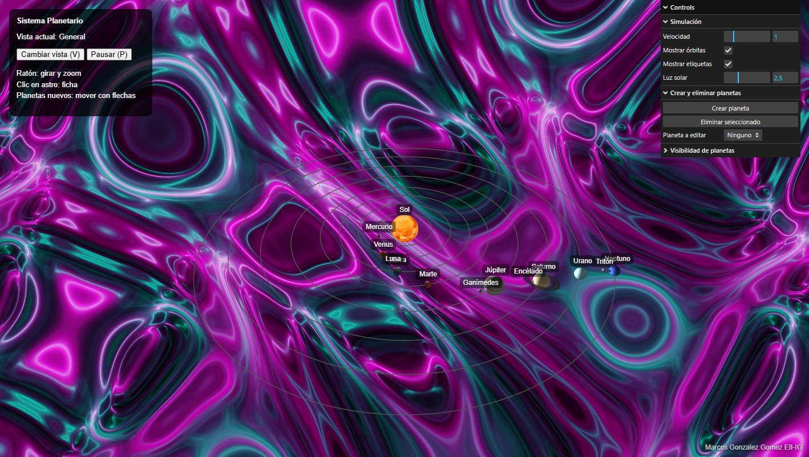
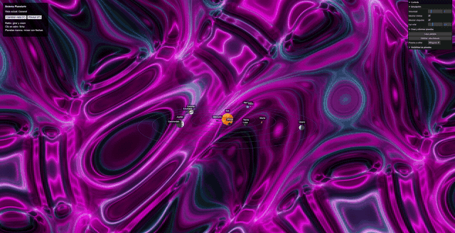

# Sistema Planetario — Fondo de la Disformidad

**Autor:** Marcos González Gómez  
**Asignatura:** Informática Gráfica  
**Práctica:** Ampliación de S6/S7 para S9/S10 — Shaders

## 1. Descripción

Copia del sistema planetario original que sustituye el fondo estelar por el shader de la **Disformidad de 504 bytes**. Se conservan los astros, texturas, iluminación, órbitas, fichas, edición y las dos cámaras. La intención es representar la Disformidad descrita en los libros de Warhammer 40K.

## 2. Ejecución

El proyecto utiliza JavaScript clásico con etiquetas `<script>`, sin imports, npm ni compilación. Las bibliotecas están incluidas en `vendor/bibliotecas.js`.

**CodeSandbox:** crear un proyecto estático y subir el contenido completo de esta carpeta, dejando `index.html` en la raíz. La vista previa abre directamente el sistema planetario. No reutilizar la configuración Node/Parcel de la importación anterior.

**Visual Studio Code:** clic derecho sobre el `index.html` de esta carpeta → Open with Live Server.

Como alternativa local, ejecutar `node servidor.mjs` y abrir `http://127.0.0.1:8100`. Este servidor es opcional; no se utiliza en CodeSandbox.

## 3. Integración

`src/fondo-warp.js` crea el material del fondo y `src/warp-nebula.js` contiene el GLSL minificado completo. Esta carpeta es independiente: no carga archivos del visor del shader. Si se modifica el GLSL, actualizar la constante `fragmentShader` en ese archivo y recargar la página.

La esfera acompaña a la cámara activa. Antes de dibujar se actualizan resolución y tiempo; la animación respeta la pausa y la velocidad existentes. El shader trabaja en coordenadas de pantalla y se dibuja antes de los planetas, sin afectar a su iluminación ni escribir profundidad. No se trata de un mapa panorámico tridimensional.

## 4. Documentación y verificación

El fondo representa la Disformidad de Warhammer 40K mediante cinco capas de coordenadas deformadas con seno, una matriz de rotación y acumulación de energía violeta y turquesa. Se utilizan los uniforms de resolución y tiempo de los ejemplos de clase. La estrategia de capas se inspira en un shader compartido por un compañero. Referencias: The Book of Shaders, documentación de Three.js y universo Warhammer 40K de Games Workshop. Se ha comprobado en Chrome la carga de esta versión clásica: render de la escena, texturas y ausencia de errores JavaScript o de carga. Las dos cámaras y la pausa también se comprobaron durante la integración original. Los auxiliares de pruebas no forman parte de la entrega final.

La base del sistema planetario es la práctica original de Marcos González Gómez. La integración y la documentación se han preparado con asistencia de Codex.

## 5. Archivos

| Archivo o carpeta | Para qué sirve |
|---|---|
| `index.html` | Entrada de la aplicación estática. |
| `vendor/bibliotecas.js` | Three.js 0.152.1, sus controles y lil-gui, empaquetados como biblioteca clásica local. |
| `src/script.js` | Código legible de la escena, astros, cámaras y controles. |
| `src/fondo-warp.js` | Crea el fondo con el shader. |
| `src/warp-nebula.js` | Constante con el shader de 504 bytes. |
| `src/Textures/` | Texturas de planetas y lunas. |
| `servidor.mjs` | Servidor local opcional para Node. |
| `preview.png`, `demo.gif` | Captura y demostración. |
| `README.md` | Documentación. |
